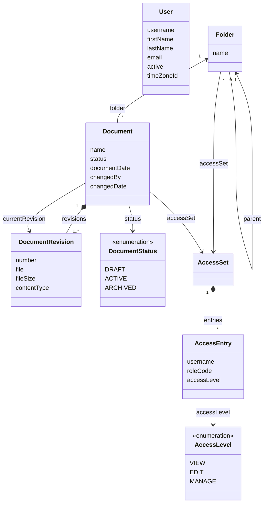

# Jmix DMS

A reference document management system built on [Jmix](https://www.jmix.io).

> **Status:** under construction. The application is assembled module by module, and this README describes only what is already in place.

## 📑 Table of Contents

- [Overview](#-overview)
- [Technical Stack](#️-technical-stack)
- [Add-ons](#-add-ons)
- [Build and Run](#-build-and-run)
- [AI Assistant](#-ai-assistant)
- [Demo Data](#-demo-data)
- [Application Accounts](#-application-accounts)
- [Domain Model](#️-domain-model)
- [Role Model](#-role-model)
- [Access](#-access)

## 📖 Overview

Jmix DMS shows how to build a document management system on Jmix and how to add AI to it. You can clone it, run it locally, and read the code as an example.

The application grows in this order:

1. Users, roles and login
2. Folders, documents, revisions, files and preview
3. Access rights with inheritance
4. Document types on dynamic attributes
5. AI classification and the assistant
6. Full-text search
7. Semantic search
8. Demo data in English and Russian

Steps 1 to 3 are in place: employees sign in, keep documents in a folder tree, upload files and new versions, move documents through their statuses, preview images, PDF and text, and share folders and documents with users and roles.

## 🛠️ Technical Stack

- Java 21, Gradle
- [Jmix](https://www.jmix.io) 3.1, Spring Boot 4, Vaadin 25 with the Aura theme
- HSQLDB, Liquibase
- OpenSearch 2.17 (used from the full-text search module on)
- JUnit 5

## 🧩 Add-ons

- [Data Tools](https://docs.jmix.io/jmix/data-tools/index.html)
- [Local File Storage](https://docs.jmix.io/jmix/files/file-storage.html)
- Russian translation of the framework (`jmix-translations-ru`)

Further add-ons come with the modules that need them.

## 🚀 Build and Run

### Prerequisites

- Java 21

### Run the application

```bash
./gradlew bootRun
```

Open <http://localhost:8080/dms> and log in as `admin` / `admin`.

By default the application keeps its data in the HSQLDB file database `.jmix/hsqldb/dms` and runs with the `local` profile, which pre-fills the login form.

| Variable | Default | Meaning |
|---|---|---|
| `DMS_ACTIVE_PROFILE` | `local` | Spring profile |
| `DMS_DB_URL` | `jdbc:hsqldb:file:.jmix/hsqldb/dms` | JDBC URL of the database |
| `DMS_DB_USERNAME` | `sa` | Database user |
| `DMS_DB_PASSWORD` | empty | Database password |
| `DMS_FILES_DIR` | `.jmix/work/filestorage` | Directory of the document files |
| `SERVER_PORT` | `8080` | HTTP port |

The database and the file directory belong together: a document version in the database points to a file in the directory. Reset, back up and copy them together.

### Run the tests

```bash
./gradlew test
```

Gradle runs the tests with the `test` profile on an in-memory HSQLDB database, so every run starts from an empty schema. The tests write files to `build/test-filestorage`, and `./gradlew clean` removes them.

### Use another database

Add the JDBC driver of your database to `build.gradle` and set `DMS_DB_URL`, `DMS_DB_USERNAME` and `DMS_DB_PASSWORD`. The Liquibase changelogs keep the branches Jmix Studio writes for different databases.

### Develop with AI agents

The repository ships the [Jmix Agent Toolkit](https://github.com/jmix-framework/jmix-agent-toolkit). Its Jmix skills live in `.skills/` and are linked for:

- Claude Code (`.claude/skills`);
- Codex and OpenCode (`.agents/skills`).

[AGENTS.md](AGENTS.md) and [CLAUDE.md](CLAUDE.md) point the agents to the toolkit's `jmix` skill.

## 🤖 AI Assistant

Not available yet: it arrives with the AI classification and semantic search modules.

## 🎲 Demo Data

Not available yet: demo document sets in English and Russian arrive with the demo data module.

## 👥 Application Accounts

| Login | Password | Name | Role |
|---|---|---|---|
| `admin` | `admin` | | Full Access |
| `peter` | `peter` | Peter Wilson | Employee |
| `alice` | `alice` | Alice Morgan | Employee |
| `helen` | `helen` | Helen Carter | Employee |
| `maria` | `maria` | Maria Lopez | Employee |
| `john` | `john` | John Doe | Employee |

The employees come from the demo changelog `020-demo-users.xml`. Delete it before the first start of a real deployment.

> **Warning:** these are development credentials, and the `local` profile pre-fills them in the login form. Before you deploy the application anywhere, change the `admin` password and set `DMS_ACTIVE_PROFILE` to another value, for example `prod`.

## ⚙️ Domain Model



- One root folder, "Repository", holds the whole tree. Names are unique among the live items of a folder and are case-sensitive.
- A revision never changes. A new file or a restored version adds a revision, and the document points to its current one.
- A new document is a draft. Draft → Active ⇄ Archived; an archived document keeps its name, date and versions until it returns to Active.
- "Modified by" and "Modified" show who changed the document itself and when: a new version, name, date or status. A move or an access change leaves them as they are, while the Jmix audit stamps of the record change with every save.
- Folders, documents and revisions are deleted softly. Deleting a folder takes its subtree; the administrator restores records in Data Tools.
- A folder and a document point to the access set in effect: their parent's or their own. An access set belongs to one folder or document, and each of its entries gives a user or a role a level.

## 🔐 Role Model

| Role | Code | Purpose |
|---|---|---|
| Full Access | `system-full-access` | All data, views and actions; assigned to `admin` |
| Employee | `employee` | Works with folders and documents and views their own profile; includes UI: minimal access |
| UI: minimal access | `ui-minimal` | Sign-in to the UI and the main view; the base of every UI role |
| Folder and document access | `access-rl` | Row-level role: a user sees and changes folders and documents by their access entries; assigned to everyone without Full Access |

A user needs one role to sign in: a persona role extends UI: minimal access. Role names and descriptions come from the message bundles, so the role views show them in the user's language.

## 🔑 Access

Access works as in SharePoint. A folder or a document either inherits the access of its parent or has its own, set in the **Access** dialog. For a folder, it opens from the folder menu and the folder's context menu; for a document, from the key on the documents toolbar, the document's context menu and the document card. Only those who manage something see the action.

| Level | Allows |
|---|---|
| View | See the folder or the document, open the card read-only, preview and download |
| Edit | Also upload, create, add versions, change the status, rename, move and delete |
| Manage | Also change who has access |

- An entry gives a level to a user or to a resource role, and a user gets the highest level among their entries. The root gives the Employee role the Edit level.
- Roles stand for departments. The administrator creates a resource role without policies, for example "HR", assigns it to the department in the role views and gives the role access to the department's folders. A change of roles applies from the user's next sign-in.
- Clearing **Inherit access** copies the inherited entries as a start; checking it again removes the own entries. A folder or a document that inherits takes the access of its new place when it is moved, and the move asks first.
- A user sees, greyed, the folders on the way to what they have access to, with their names. A key after the name marks a folder or a document with its own access for those who manage it.
- The administrator has every level everywhere, without entries.
- With LDAP or Active Directory, map each department group to its resource role and keep the access entries on roles rather than on users.

> **Warning:** the `access-rl` role comes from the Jmix role assignments. If users sign in through LDAP or SSO and get their roles from a group mapper, add `access-rl` in the mapper, or they will see every folder and document.
