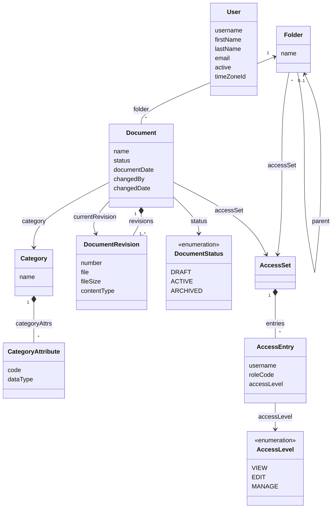

# Jmix DMS

A reference document management system built on [Jmix](https://www.jmix.io).

> **Status:** under construction. The application is assembled module by module, and this README describes only what is already in place.

## 📑 Table of Contents

- [Overview](#-overview)
- [Technical Stack](#️-technical-stack)
- [Add-ons](#-add-ons)
- [Build and Run](#-build-and-run)
- [AI Assistant](#-ai-assistant)
- [Demo Data](#-demo-data)
- [Application Accounts](#-application-accounts)
- [Domain Model](#️-domain-model)
- [Role Model](#-role-model)
- [Access](#-access)
- [Document Types](#-document-types)
- [Full-Text Search](#-full-text-search)
- [Semantic Search](#-semantic-search)

## 📖 Overview

Jmix DMS shows how to build a document management system on Jmix and how to add AI to it. You can clone it, run it locally, and read the code as an example.

The application grows in this order:

1. Users, roles and login
2. Folders, documents, revisions, files and preview
3. Access rights with inheritance
4. Document types on dynamic attributes
5. Full-text search
6. AI classification and the assistant
7. Semantic search
8. Demo data in English and Russian

Steps 1 to 8 are in place: employees sign in, keep documents in a folder tree, upload files and new versions, move documents through their statuses, preview images, PDF and text, share folders and documents with users and roles, mark documents with types whose fields the administrator defines, find documents by the words of their files or by the meaning of a query, let the AI fill the type and the fields of a document from its file, ask the AI about a document in its card, and ask the AI assistant in the menu about the documents, the folders and the document types. An empty database gets a demo set of documents in English or Russian at the first start.

## 🛠️ Technical Stack

- Java 21, Gradle
- [Jmix](https://www.jmix.io) 3.1, Spring Boot 4, Vaadin 25 with the Aura theme
- HSQLDB, Liquibase
- OpenSearch 2.17 in Docker Compose
- [Spring AI](https://docs.spring.io/spring-ai/reference/) 2.0 with OpenAI
- JUnit 5

## 🧩 Add-ons

- AI Chat: the chat of the assistant in the document card; an experimental add-on of the Jmix Enterprise subscription
- AI Tools: the assistant in the main menu, its tools over the data and the history of its chats
- [Data Tools](https://docs.jmix.io/jmix/data-tools/index.html)
- [Dynamic Attributes](https://docs.jmix.io/jmix/dyn-attr/index.html)
- [Local File Storage](https://docs.jmix.io/jmix/files/file-storage.html)
- [Quartz](https://docs.jmix.io/jmix/quartz/index.html): runs the indexing queue of the search
- [Search](https://docs.jmix.io/jmix/search/index.html) with OpenSearch
- Russian translation of the framework (`jmix-translations-ru`)

Further add-ons come with the modules that need them.

## 🚀 Build and Run

### Prerequisites

- Java 21
- Docker with Docker Compose, for OpenSearch
- Credentials of the Jmix premium repository, for the AI Chat add-on: they come with a Jmix Enterprise subscription or its trial

The build takes the AI Chat add-on from the premium repository of Jmix. Put the credentials into `~/.gradle/gradle.properties`: the part of your license key before the dash is the user name, and the part after it is the password.

```properties
premiumRepoUser=123456123456
premiumRepoPass=abcdefabcdef
```

### Run the application

```bash
docker compose up -d --wait
./gradlew bootRun
```

`docker compose up -d --wait` starts OpenSearch for full-text and semantic search on `127.0.0.1:19200` and returns once it answers, so that the application finds it at start. Without OpenSearch the application works, and the search says it is unavailable; if OpenSearch comes up later, restart the application, and the changes waiting in the queue are indexed then.

Open <http://localhost:8080/dms> and log in as `admin` / `admin`. The first start fills the empty database with the English demo set, see [Demo Data](#-demo-data).

By default the application keeps its data in the HSQLDB file database `.jmix/hsqldb/dms` and runs with the `local` profile, which pre-fills the login form.

| Variable | Default | Meaning |
|---|---|---|
| `DMS_ACTIVE_PROFILE` | `local` | Spring profile |
| `DMS_DB_URL` | `jdbc:hsqldb:file:.jmix/hsqldb/dms` | JDBC URL of the database |
| `DMS_DB_USERNAME` | `sa` | Database user |
| `DMS_DB_PASSWORD` | empty | Database password |
| `DMS_FILES_DIR` | `.jmix/work/filestorage` | Directory of the document files |
| `DMS_SEARCH_URL` | `http://localhost:19200` | Address of OpenSearch |
| `OPENAI_API_KEY` | empty | Key of the OpenAI API; without it the application shows no AI features |
| `DMS_AI_MODEL` | `gpt-5.6-luna` | OpenAI model of the AI features |
| `DMS_AI_EMBEDDING_MODEL` | `text-embedding-3-large` | OpenAI model of the vectors of the semantic search, of the text-embedding-3 family; another model fills the index anew |
| `DMS_AI_EMBEDDING_DIMENSIONS` | `3072` | Size of the vectors of the semantic search, set with the model: at most 3072 for text-embedding-3-large and 1536 for text-embedding-3-small; another size fills the index anew |
| `DMS_AI_REASONING_EFFORT` | `none` | Reasoning effort of the model; gpt-5.6-luna calls tools only with `none`, and a model that does not reason, such as gpt-4o-mini, refuses the setting: remove `spring.ai.openai.chat.reasoning-effort` from `application.properties` for it |
| `DMS_AI_TEMPERATURE` | `0` | Temperature of the model; a model that reasons takes only `1` |
| `DMS_DEMO_DATA` | `en` | Demo set an empty database gets at the start in the `local` profile: `en`, `ru` or `none` |
| `SERVER_PORT` | `8080` | HTTP port |

The database and the file directory belong together: a document version in the database points to a file in the directory. Reset, back up and copy them together. The search indexes follow them: `./gradlew resetDemoData` deletes all three for a fresh start, see [Demo Data](#-demo-data). After the database is replaced in another way, run `docker compose down -v` to remove the indexes, and the application fills them again at start.

### Run the tests

```bash
./gradlew test
```

Gradle runs the tests with the `test` profile on an in-memory HSQLDB database, so every run starts from an empty schema. The tests write files to `build/test-filestorage`, and `./gradlew clean` removes them. Search is off in these tests, so they need no OpenSearch.

The tests of full-text search run against OpenSearch from `compose.yaml`, in indexes of their own (`dms_test_`):

```bash
docker compose up -d --wait
./gradlew searchTest
```

The AI tests call the OpenAI models with the key from `OPENAI_API_KEY` and check how the model classifies the English samples next to them, how the assistant of the card answers about one of them, how the assistant in the menu lists, finds, counts and reads documents and answers in the language of the question, and how the semantic search finds the samples by meaning, on the page and in the chat, and the twelve documents about farm equipment of the English demo set. They index the samples in OpenSearch from `compose.yaml` (`dms_test_`); a run costs a few cents:

```bash
docker compose up -d --wait
./gradlew aiTest
```

The other tests clear the key, so they never call the model.

### Use another database

Add the JDBC driver of your database to `build.gradle` and set `DMS_DB_URL`, `DMS_DB_USERNAME` and `DMS_DB_PASSWORD`. The Liquibase changelogs keep the branches Jmix Studio writes for different databases.

### Develop with AI agents

The repository ships the [Jmix Agent Toolkit](https://github.com/jmix-framework/jmix-agent-toolkit). Its Jmix skills live in `.skills/` and are linked for:

- Claude Code (`.claude/skills`);
- Codex and OpenCode (`.agents/skills`).

[AGENTS.md](AGENTS.md) and [CLAUDE.md](CLAUDE.md) point the agents to the toolkit's `jmix` skill.

## 🤖 AI Assistant

The AI features need an OpenAI key in `OPENAI_API_KEY`; without the key the application works as before and shows none of them. They run on [Spring AI](https://docs.spring.io/spring-ai/reference/): another provider, a local model included, takes a different Spring AI starter, its properties and a new check in `AiSettings`, which turns the AI features on while the OpenAI key is set.

- **Fill with AI.** The button in the header of the document card reads the file the card shows, the saved one or a file just uploaded, and fills the type of the document, the fields of the type and the document date. The values go into the form only: you check them and save the document as usual. A document that already has a type or a date asks before the AI replaces them.
- The types and their fields come from the document types the administrator defines, so a new type or field reaches the AI without a change of the code. Fields that hold a list of values or a reference to another record are left for you to fill.
- The AI reads the text of the file: PDF, Office and OpenDocument files, RTF, HTML, plain text. A scan or a PDF made of pictures has no text, and the card says so. A long document is read up to its first 12,000 characters (`dms.ai.max-text-length`), and the AI is told where the text stops.
- **Assistant.** The Assistant tab of a saved document is a chat with the AI about the document, next to its preview. Ask in your own words or take a suggestion, "Summary" or "Dates and amounts". The AI reads the text of the saved current version with your rights: a version that waits for OK is not what it reads. While it reads, the chat shows what it does in the AI's own words, and the answer appears as the AI writes it. The conversation lasts while the card is open and is not stored.
- **Assistant in the menu.** The AI assistant item of the main menu opens a chat about the whole repository, on the AI Tools add-on. Ask which documents there are, how many documents a folder holds, which documents have a status or a type, which invoices a supplier sent or fall due before a date, or what a document says: the AI knows the document types and their fields, writes queries over the documents, the folders and the document types, finds documents by a value or a range of the fields of their types and reads the text of a document. It finds the passages of the documents by meaning, for a question about what the documents say or which of them concern something (see [Semantic Search](#-semantic-search)), and answers with quotes. It answers in the language of the question and names the documents it finds with links to their cards. The chats are kept, and each person sees their own.
- The assistant in the menu sees only what you may open: the rights to documents and folders apply to every entity a query reads, whatever names the query gives them, and a query that reads documents where the rights cannot apply is refused. Access sets, access entries, users and versions are closed to it in the code (`@ExcludeFromAi`), so a setting cannot open them.
- To fill a document, the OpenAI model gets the text of the file, the name of the document and the document types with their fields; only a user who may edit the document can fill it. The assistant sends the model the name and the id of the document, your questions with the answers so far, the text of the document once it reads it, and the document types with their fields when it proposes a type; anyone who may open the document can ask about it. The assistant in the menu sends the model your questions with the answers so far, the description of the documents, the folders and the types, the document types with their fields, the rows of its queries and searches (names, dates, statuses, folders, types, who uploaded the documents and when, and the values of their fields), the passages it finds by meaning, and the text of a document it reads. The semantic search sends the texts of all documents to OpenAI, see [Semantic Search](#-semantic-search).

The pages of the application load pictures, media, styles and fonts from the application only (`Content-Security-Policy` with `img-src`, `media-src`, `style-src` and `font-src`): an answer in Markdown cannot send data to another site in the address of a picture, a sound, a video, a style or a font.

## 🎲 Demo Data

At the first start in the `local` profile, an empty database gets a demo set: folders with their access, 46 documents with their versions, types, fields and statuses, and the files of the versions. `DMS_DEMO_DATA` chooses the set:

| Value | Set |
|---|---|
| `en` | English documents, the default |
| `ru` | Russian documents, the set of the webinar |
| `none` | No demo data |

Both sets have the same folders, people and scenes:

| Folder | Access | What to try |
|---|---|---|
| Inbox | Inherits: every employee edits | Three scans without a type for **Fill with AI** |
| Contracts | Inherits | A lease agreement with three versions by John, Maria and Alice, its term and price written plainly for the assistant in the card; an archived lease; a recruitment agreement open to Helen only |
| Invoices and Certificates | Inherits | An invoice due on November 30, 2026, for the assistant in the menu |
| Procurement | Inherits | 27 documents of the corpus of the semantic search |
| Archive 2025 | Legal department and Accounting view, Alice edits | 3 more documents of the corpus |
| HR | HR department manages | A hiring order and an employment contract |
| HR / Vacations | HR department manages, every employee views | The vacation schedule |

The corpus holds 12 documents about farm machinery, such as a tractor lease, a combine harvester purchase and a memo about a baler, and 18 about other machinery and goods. None of them says "agricultural": search by words for *agricultural machinery* finds nothing, *tractor* and *combine* find a few documents each, and **AI search** finds the 12. Signed in as `peter`, who may not open Archive 2025, the AI search finds 9. Search by words for *fumigation* finds the one contract that has the word inside its PDF only; the Russian set has the Russian word for it.

`demo-uploads/en` and `demo-uploads/ru` hold two files the set does not load: Invoice 1610, to fill a card by hand or with AI, and Invoice 2231 for a combine harvester under a neutral name, to upload during a demo and find with the AI search.

The set loads once, into a database with no document and no folder but the root. It loads all of it or nothing: a problem of the description or a failure while loading leaves the database empty, and the log says why. To start over, stop the application and run:

```bash
./gradlew resetDemoData
```

It deletes the database, the document files and the search indexes `dms_document` and `dms_document_vectors`, and the next start loads the set of `DMS_DEMO_DATA` again. With an OpenAI key, the semantic search indexes a set in about a minute for about a cent.

A set lies in `src/main/resources/com/company/dms/demo/<set>/`: `demo-data.json` describes the folders with their access and the documents with their versions (file, author, upload time), types, fields and statuses, and `files/` holds the versions. The users, the department roles and the document types are not in it: the changelogs and the code define them. The PDFs use PT Serif and PT Sans by ParaType, under the SIL Open Font License.

## 👥 Application Accounts

| Login | Password | Name | Roles | In the demo sets |
|---|---|---|---|---|
| `admin` | `admin` | | Full Access | Administrator |
| `peter` | `peter` | Peter Wilson | Employee | An employee with a narrow access |
| `alice` | `alice` | Alice Morgan | Employee | Office manager: files the incoming documents |
| `helen` | `helen` | Helen Carter | Employee, HR department | HR manager |
| `maria` | `maria` | Maria Lopez | Employee, Accounting | Accountant |
| `john` | `john` | John Doe | Employee, Legal department | Lawyer |

The employees and their department roles come from the demo changelog `020-demo-users.xml`. Delete it before the first start of a real deployment.

> **Warning:** these are development credentials, and the `local` profile pre-fills them in the login form. Before you deploy the application anywhere, change the `admin` password and set `DMS_ACTIVE_PROFILE` to another value, for example `prod`.

## ⚙️ Domain Model



- One root folder, "Repository", holds the whole tree. Names are unique among the live items of a folder and are case-sensitive.
- A revision never changes. A new file or a restored version adds a revision, and the document points to its current one.
- A new document is a draft. Draft → Active ⇄ Archived; an archived document keeps its name, date, type, fields and versions until it returns to Active.
- "Modified by" and "Modified" show who changed the document itself and when: a new version, name, date, type, field or status. A move or an access change leaves them as they are, while the Jmix audit stamps of the record change with every save.
- The type of a document is a category of the Dynamic Attributes add-on (`Category`), and the fields of the type are its attributes (`CategoryAttribute`), properties of the document named `+code`.
- Folders, documents and revisions are deleted softly. Deleting a folder takes its subtree; the administrator restores records in Data Tools.
- A folder and a document point to the access set in effect: their parent's or their own. An access set belongs to one folder or document, and each of its entries gives a user or a role a level.

## 🔐 Role Model

| Role | Code | Purpose |
|---|---|---|
| Full Access | `system-full-access` | All data, views and actions; assigned to `admin` |
| Employee | `employee` | Works with folders and documents, reads the document types, searches documents, asks the AI assistant and views their own profile; includes UI: minimal access and the chat role of AI Tools |
| UI: minimal access | `ui-minimal` | Sign-in to the UI and the main view; the base of every UI role |
| Folder and document access | `access-rl` | Row-level role: a user sees and changes folders and documents by their access entries; assigned to everyone without Full Access |
| HR department, Legal department, Accounting | `hr-department`, `legal-department`, `accounting` | Departments of the demo: roles without policies that folders and documents give access to; the demo changelog assigns them to `helen`, `john` and `maria` |

A user needs one role to sign in: a persona role extends UI: minimal access. Role names and descriptions come from the message bundles, so the role views show them in the user's language.

The Employee role may change every attribute of a document. The fields of document types are attributes that the administrator adds later, so a role cannot list them. Attribute policies guard only the views: what is written is decided by the document service, and the Edit level is checked there and by `access-rl`.

## 🔑 Access

Access works as in SharePoint. A folder or a document either inherits the access of its parent or has its own, set in the **Access** dialog. For a folder, it opens from the folder menu and the folder's context menu; for a document, from the key on the documents toolbar, the document's context menu and the document card. Only those who manage something see the action.

| Level | Allows |
|---|---|
| View | See the folder or the document, open the card read-only, preview and download |
| Edit | Also upload, create, add versions, change the status, rename, move and delete |
| Manage | Also change who has access |

- An entry gives a level to a user or to a resource role, and a user gets the highest level among their entries. The root gives the Employee role the Edit level.
- Roles stand for departments. The demo comes with three of them in the code: HR department, Legal department and Accounting. The administrator adds more as resource roles without policies in the role views, assigns them to the department and gives them access to the department's folders. A change of roles applies from the user's next sign-in.
- Clearing **Inherit access** copies the inherited entries as a start; checking it again removes the own entries. A folder or a document that inherits takes the access of its new place when it is moved, and the move asks first.
- A user sees, greyed, the folders on the way to what they have access to, with their names. A key after the name marks a folder or a document with its own access for those who manage it.
- The administrator has every level everywhere, without entries.
- With LDAP or Active Directory, map each department group to its resource role and keep the access entries on roles rather than on users.

> **Warning:** the `access-rl` role comes from the Jmix role assignments. If users sign in through LDAP or SSO and get their roles from a group mapper, add `access-rl` in the mapper, or they will see every folder and document.

## 📋 Document Types

A document may have a type, and each type has fields of its own. Types and fields are categories and attributes of the [Dynamic Attributes](https://docs.jmix.io/jmix/dyn-attr/index.html) add-on, so the administrator adds them in the application, with no code and no restart.

| Type | Fields |
|---|---|
| Contract | Contract number, Contract kind (Supply, Lease, Work, Services, Leasing), Counterparty, Amount, Valid until |
| Invoice | Invoice number, Supplier, Amount, Due date |
| Completion certificate | Contractor, Amount, Work completed on, Basis contract |
| HR document | Employee, Department, Hire date |

- The four types come from the changelog `060-document-types.xml` with English and Russian names; the documents bring the values of their fields.
- The type and its fields are on the **Properties** tab of the document card. A new type replaces the fields on the tab, and OK deletes the values of the fields that the new type does not have.
- A type is optional. A field marked as required makes the card ask for it, once the **Properties** tab has been shown.
- The administrator opens **Document types** in the main menu: the add-on's view of categories and their attributes. A saved type or field shows in the cards at once, with no **Apply changes**.
- A type that documents are marked with cannot be deleted; change the type of those documents first.

## 🔎 Full-Text Search

The search field in the header finds documents by the words of their files: the text of a PDF, DOC, DOCX, XLS, XLSX, ODT, ODS, RTF or TXT file of the current version, the document name, the file name and the text fields of the document type. Search runs on the [Search](https://docs.jmix.io/jmix/search/index.html) add-on with OpenSearch.

- Word forms match in Russian and in English: "contracts" finds "contract", and a Russian word finds its other forms as well.
- The results show the documents a user may see, 20 at a time with **Show more**: the folder, the type, the status and the text around the found words. A click on the name opens the document card. The results never tell how many other documents match.
- Not searched: the status, the folder, the type name, older versions, and numbers and dates, which the add-on does not index.
- Changes reach the search within seconds: the add-on puts them into a queue, and a [Quartz](https://docs.jmix.io/jmix/quartz/index.html) job sends it to OpenSearch every five seconds. A deleted document leaves the search at once.
- On start, the application fills an empty index with all documents, for example after the index schema changes.

## 🧠 Semantic Search

With the AI on, the search field in the header has a second mode. **By words** is the full-text search above; a click on it switches to **AI search**, which finds documents by the meaning of a query: "agricultural machinery" finds the lease of a tractor, the invoice for a combine and a memo about a broken baler, though none of them names agricultural machinery.

- The field shows the mode, and the address of the results keeps it (`mode=ai`), so a link and Back search the same way. Each person's last choice is remembered; the default is by words. A click on the mode on the results page runs the same query in the other mode.
- The AI search finds the fragments of the documents nearest to the query by meaning, and the OpenAI chat model checks every candidate: the page shows up to 20 documents that fit, the nearest first, each with its fragment and the quote that fits the query marked. When nothing fits, the page offers the search by words.
- The assistant in the menu finds passages by meaning too, for a question about what the documents say or which of them concern something, and answers with quotes and links to the cards.
- The rights apply when a person searches: the index holds the fragments of all documents, and the application asks it only among the documents the person may open, so a closed document is neither shown, nor checked, nor quoted.
- **The texts of all documents go to OpenAI.** While the key is set, every document is sent to the OpenAI model of vectors when it is uploaded, gets another current version or another name, whoever opens it later: its name and the first 40,000 characters of its text (`dms.semantic.max-text-length`), in fragments of about 1,000 characters. A file without text is searched by its name. A search sends the query, and the results page also the names and fragments of up to 20 documents for the check. Indexing costs about $0.0002 for a document of two pages, a search on the page about $0.002.
- The fragments live in the OpenSearch index `dms_document_vectors`, next to the index of full-text search, with the vectors of `text-embedding-3-large` (3,072 numbers each). A document is found by meaning a few seconds after an upload. At start the application checks the index against the documents: it indexes what changed while it was stopped, removes what is gone, and fills the index anew when the model of vectors changes. Until then the results page says that part of the documents cannot be found by meaning yet. Without OpenSearch the AI search says that search is unavailable.
