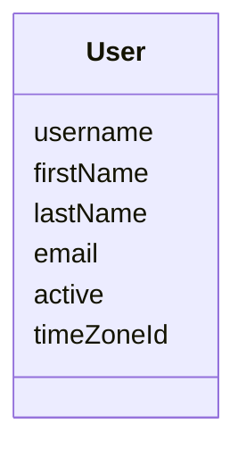

# Jmix DMS

A reference document management system built on [Jmix](https://www.jmix.io).

> **Status:** under construction. The application is assembled module by module, and this README describes only what is already in place.

## 📑 Table of Contents

- [Overview](#-overview)
- [Technical Stack](#️-technical-stack)
- [Add-ons](#-add-ons)
- [Build and Run](#-build-and-run)
- [AI Assistant](#-ai-assistant)
- [Demo Data](#-demo-data)
- [Application Accounts](#-application-accounts)
- [Domain Model](#️-domain-model)
- [Role Model](#-role-model)

## 📖 Overview

Jmix DMS shows how to build a document management system on Jmix and how to add AI to it. You can clone it, run it locally, and read the code as an example.

The application grows in this order:

1. Users, roles and login
2. Folders, documents, revisions, files and preview
3. Access rights with inheritance
4. Document types on dynamic attributes
5. AI classification and the assistant
6. Full-text search
7. Semantic search
8. Demo data in English and Russian

Right now the application has the skeleton: users, login, the main view, the English and Russian UI, and the test setup.

## 🛠️ Technical Stack

- Java 21, Gradle
- [Jmix](https://www.jmix.io) 3.1 (3.1.0-RC1 until the release), Spring Boot 4, Vaadin 25 with the Aura theme
- HSQLDB, Liquibase
- OpenSearch 2.17 (used from the full-text search module on)
- JUnit 5

## 🧩 Add-ons

- [Data Tools](https://docs.jmix.io/jmix/data-tools/index.html)
- [Local File Storage](https://docs.jmix.io/jmix/files/file-storage.html)
- Russian translation of the framework (`jmix-translations-ru`)

Further add-ons come with the modules that need them.

## 🚀 Build and Run

### Prerequisites

- Java 21

### Run the application

```bash
./gradlew bootRun
```

Open <http://localhost:8080/dms> and log in as `admin` / `admin`.

By default the application keeps its data in the HSQLDB file database `.jmix/hsqldb/dms` and runs with the `local` profile, which pre-fills the login form.

| Variable | Default | Meaning |
|---|---|---|
| `DMS_ACTIVE_PROFILE` | `local` | Spring profile |
| `DMS_DB_URL` | `jdbc:hsqldb:file:.jmix/hsqldb/dms` | JDBC URL of the database |
| `DMS_DB_USERNAME` | `sa` | Database user |
| `DMS_DB_PASSWORD` | empty | Database password |
| `SERVER_PORT` | `8080` | HTTP port |

### Run the tests

```bash
./gradlew test
```

Gradle runs the tests with the `test` profile on an in-memory HSQLDB database, so every run starts from an empty schema.

### Use another database

Add the JDBC driver of your database to `build.gradle` and set `DMS_DB_URL`, `DMS_DB_USERNAME` and `DMS_DB_PASSWORD`. The Liquibase changelogs keep the branches Jmix Studio writes for different databases.

### Develop with AI agents

The repository ships the [Jmix Agent Toolkit](https://github.com/jmix-framework/jmix-agent-toolkit). Its Jmix skills live in `.skills/` and are linked for:

- Claude Code (`.claude/skills`);
- Codex and OpenCode (`.agents/skills`).

[AGENTS.md](AGENTS.md) and [CLAUDE.md](CLAUDE.md) point the agents to the toolkit's `jmix` skill.

## 🤖 AI Assistant

Not available yet: it arrives with the AI classification and semantic search modules.

## 🎲 Demo Data

Not available yet: demo document sets in English and Russian arrive with the demo data module.

## 👥 Application Accounts

| Login | Password | Roles |
|---|---|---|
| `admin` | `admin` | Full Access |

> **Warning:** these are development credentials, and the `local` profile pre-fills them in the login form. Before you deploy the application anywhere, change the `admin` password and set `DMS_ACTIVE_PROFILE` to another value, for example `prod`.

## ⚙️ Domain Model



## 🔐 Role Model

| Role | Code | Purpose |
|---|---|---|
| Full Access | `system-full-access` | Everything; assigned to `admin` |
| UI: minimal access | `ui-minimal` | Login and the main view; the base of every UI role |
