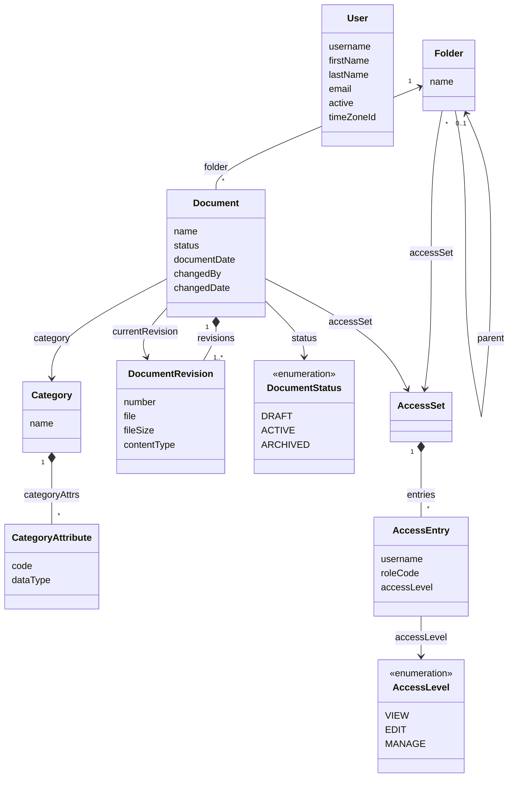

# Jmix DMS

A reference document management system built on [Jmix](https://www.jmix.io).

> **Status:** under construction. The application is assembled module by module, and this README describes only what is already in place.

## 📑 Table of Contents

- [Overview](#-overview)
- [Technical Stack](#️-technical-stack)
- [Add-ons](#-add-ons)
- [Build and Run](#-build-and-run)
- [AI Assistant](#-ai-assistant)
- [Demo Data](#-demo-data)
- [Application Accounts](#-application-accounts)
- [Domain Model](#️-domain-model)
- [Role Model](#-role-model)
- [Access](#-access)
- [Document Types](#-document-types)
- [Full-Text Search](#-full-text-search)

## 📖 Overview

Jmix DMS shows how to build a document management system on Jmix and how to add AI to it. You can clone it, run it locally, and read the code as an example.

The application grows in this order:

1. Users, roles and login
2. Folders, documents, revisions, files and preview
3. Access rights with inheritance
4. Document types on dynamic attributes
5. Full-text search
6. AI classification and the assistant
7. Semantic search
8. Demo data in English and Russian

Steps 1 to 5 are in place, and step 6 has begun: employees sign in, keep documents in a folder tree, upload files and new versions, move documents through their statuses, preview images, PDF and text, share folders and documents with users and roles, mark documents with types whose fields the administrator defines, find documents by the words of their files, and let the AI fill the type and the fields of a document from its file.

## 🛠️ Technical Stack

- Java 21, Gradle
- [Jmix](https://www.jmix.io) 3.1, Spring Boot 4, Vaadin 25 with the Aura theme
- HSQLDB, Liquibase
- OpenSearch 2.17 in Docker Compose
- [Spring AI](https://docs.spring.io/spring-ai/reference/) 2.0 with OpenAI
- JUnit 5

## 🧩 Add-ons

- [Data Tools](https://docs.jmix.io/jmix/data-tools/index.html)
- [Dynamic Attributes](https://docs.jmix.io/jmix/dyn-attr/index.html)
- [Local File Storage](https://docs.jmix.io/jmix/files/file-storage.html)
- [Quartz](https://docs.jmix.io/jmix/quartz/index.html): runs the indexing queue of the search
- [Search](https://docs.jmix.io/jmix/search/index.html) with OpenSearch
- Russian translation of the framework (`jmix-translations-ru`)

Further add-ons come with the modules that need them.

## 🚀 Build and Run

### Prerequisites

- Java 21
- Docker with Docker Compose, for OpenSearch

### Run the application

```bash
docker compose up -d --wait
./gradlew bootRun
```

`docker compose up -d --wait` starts OpenSearch for full-text search on `127.0.0.1:19200` and returns once it answers, so that the application finds it at start. Without OpenSearch the application works, and the search says it is unavailable; if OpenSearch comes up later, restart the application, and the changes waiting in the queue are indexed then.

Open <http://localhost:8080/dms> and log in as `admin` / `admin`.

By default the application keeps its data in the HSQLDB file database `.jmix/hsqldb/dms` and runs with the `local` profile, which pre-fills the login form.

| Variable | Default | Meaning |
|---|---|---|
| `DMS_ACTIVE_PROFILE` | `local` | Spring profile |
| `DMS_DB_URL` | `jdbc:hsqldb:file:.jmix/hsqldb/dms` | JDBC URL of the database |
| `DMS_DB_USERNAME` | `sa` | Database user |
| `DMS_DB_PASSWORD` | empty | Database password |
| `DMS_FILES_DIR` | `.jmix/work/filestorage` | Directory of the document files |
| `DMS_SEARCH_URL` | `http://localhost:19200` | Address of OpenSearch |
| `OPENAI_API_KEY` | empty | Key of the OpenAI API; without it the application shows no AI features |
| `DMS_AI_MODEL` | `gpt-4o-mini` | OpenAI model of the AI features |
| `DMS_AI_TEMPERATURE` | `0` | Temperature of the model; a reasoning model takes only `1` |
| `SERVER_PORT` | `8080` | HTTP port |

The database and the file directory belong together: a document version in the database points to a file in the directory. Reset, back up and copy them together. The search index follows them: after the database is reset or replaced, run `docker compose down -v` to remove the index, and the application fills it again at start.

### Run the tests

```bash
./gradlew test
```

Gradle runs the tests with the `test` profile on an in-memory HSQLDB database, so every run starts from an empty schema. The tests write files to `build/test-filestorage`, and `./gradlew clean` removes them. Search is off in these tests, so they need no OpenSearch.

The tests of full-text search run against OpenSearch from `compose.yaml`, in indexes of their own (`dms_test_`):

```bash
docker compose up -d --wait
./gradlew searchTest
```

The AI tests call the OpenAI model with the key from `OPENAI_API_KEY` and check how it classifies the English samples next to them; a run costs a few cents:

```bash
./gradlew aiTest
```

The other tests clear the key, so they never call the model.

### Use another database

Add the JDBC driver of your database to `build.gradle` and set `DMS_DB_URL`, `DMS_DB_USERNAME` and `DMS_DB_PASSWORD`. The Liquibase changelogs keep the branches Jmix Studio writes for different databases.

### Develop with AI agents

The repository ships the [Jmix Agent Toolkit](https://github.com/jmix-framework/jmix-agent-toolkit). Its Jmix skills live in `.skills/` and are linked for:

- Claude Code (`.claude/skills`);
- Codex and OpenCode (`.agents/skills`).

[AGENTS.md](AGENTS.md) and [CLAUDE.md](CLAUDE.md) point the agents to the toolkit's `jmix` skill.

## 🤖 AI Assistant

The AI features need an OpenAI key in `OPENAI_API_KEY`; without the key the application works as before and shows none of them. They run on [Spring AI](https://docs.spring.io/spring-ai/reference/): another provider, a local model included, takes a different Spring AI starter, its properties and a new check in `AiSettings`, which turns the AI features on while the OpenAI key is set.

- **Fill with AI.** The button in the header of the document card reads the file the card shows, the saved one or a file just uploaded, and fills the type of the document, the fields of the type and the document date. The values go into the form only: you check them and save the document as usual. A document that already has a type or a date asks before the AI replaces them.
- The types and their fields come from the document types the administrator defines, so a new type or field reaches the AI without a change of the code. Fields that hold a list of values or a reference to another record are left for you to fill.
- The AI reads the text of the file: PDF, Office and OpenDocument files, RTF, HTML, plain text. A scan or a PDF made of pictures has no text, and the card says so. A long document is read up to its first 12,000 characters (`dms.ai.max-text-length`).
- The OpenAI model gets the text of the file, the name of the document and the document types with their fields. Only a user who may edit the document can fill it.

The assistant in the card and the assistant across the documents arrive with the next parts of this step.

## 🎲 Demo Data

Not available yet: demo document sets in English and Russian arrive with the demo data module.

## 👥 Application Accounts

| Login | Password | Name | Role |
|---|---|---|---|
| `admin` | `admin` | | Full Access |
| `peter` | `peter` | Peter Wilson | Employee |
| `alice` | `alice` | Alice Morgan | Employee |
| `helen` | `helen` | Helen Carter | Employee |
| `maria` | `maria` | Maria Lopez | Employee |
| `john` | `john` | John Doe | Employee |

The employees come from the demo changelog `020-demo-users.xml`. Delete it before the first start of a real deployment.

> **Warning:** these are development credentials, and the `local` profile pre-fills them in the login form. Before you deploy the application anywhere, change the `admin` password and set `DMS_ACTIVE_PROFILE` to another value, for example `prod`.

## ⚙️ Domain Model



- One root folder, "Repository", holds the whole tree. Names are unique among the live items of a folder and are case-sensitive.
- A revision never changes. A new file or a restored version adds a revision, and the document points to its current one.
- A new document is a draft. Draft → Active ⇄ Archived; an archived document keeps its name, date, type, fields and versions until it returns to Active.
- "Modified by" and "Modified" show who changed the document itself and when: a new version, name, date, type, field or status. A move or an access change leaves them as they are, while the Jmix audit stamps of the record change with every save.
- The type of a document is a category of the Dynamic Attributes add-on (`Category`), and the fields of the type are its attributes (`CategoryAttribute`), properties of the document named `+code`.
- Folders, documents and revisions are deleted softly. Deleting a folder takes its subtree; the administrator restores records in Data Tools.
- A folder and a document point to the access set in effect: their parent's or their own. An access set belongs to one folder or document, and each of its entries gives a user or a role a level.

## 🔐 Role Model

| Role | Code | Purpose |
|---|---|---|
| Full Access | `system-full-access` | All data, views and actions; assigned to `admin` |
| Employee | `employee` | Works with folders and documents, reads the document types, searches documents and views their own profile; includes UI: minimal access |
| UI: minimal access | `ui-minimal` | Sign-in to the UI and the main view; the base of every UI role |
| Folder and document access | `access-rl` | Row-level role: a user sees and changes folders and documents by their access entries; assigned to everyone without Full Access |

A user needs one role to sign in: a persona role extends UI: minimal access. Role names and descriptions come from the message bundles, so the role views show them in the user's language.

The Employee role may change every attribute of a document. The fields of document types are attributes that the administrator adds later, so a role cannot list them. Attribute policies guard only the views: what is written is decided by the document service, and the Edit level is checked there and by `access-rl`.

## 🔑 Access

Access works as in SharePoint. A folder or a document either inherits the access of its parent or has its own, set in the **Access** dialog. For a folder, it opens from the folder menu and the folder's context menu; for a document, from the key on the documents toolbar, the document's context menu and the document card. Only those who manage something see the action.

| Level | Allows |
|---|---|
| View | See the folder or the document, open the card read-only, preview and download |
| Edit | Also upload, create, add versions, change the status, rename, move and delete |
| Manage | Also change who has access |

- An entry gives a level to a user or to a resource role, and a user gets the highest level among their entries. The root gives the Employee role the Edit level.
- Roles stand for departments. The administrator creates a resource role without policies, for example "HR", assigns it to the department in the role views and gives the role access to the department's folders. A change of roles applies from the user's next sign-in.
- Clearing **Inherit access** copies the inherited entries as a start; checking it again removes the own entries. A folder or a document that inherits takes the access of its new place when it is moved, and the move asks first.
- A user sees, greyed, the folders on the way to what they have access to, with their names. A key after the name marks a folder or a document with its own access for those who manage it.
- The administrator has every level everywhere, without entries.
- With LDAP or Active Directory, map each department group to its resource role and keep the access entries on roles rather than on users.

> **Warning:** the `access-rl` role comes from the Jmix role assignments. If users sign in through LDAP or SSO and get their roles from a group mapper, add `access-rl` in the mapper, or they will see every folder and document.

## 📋 Document Types

A document may have a type, and each type has fields of its own. Types and fields are categories and attributes of the [Dynamic Attributes](https://docs.jmix.io/jmix/dyn-attr/index.html) add-on, so the administrator adds them in the application, with no code and no restart.

| Type | Fields |
|---|---|
| Contract | Contract number, Contract kind (Supply, Lease, Work, Services, Leasing), Counterparty, Amount, Valid until |
| Invoice | Invoice number, Supplier, Amount, Due date |
| Completion certificate | Contractor, Amount, Work completed on, Basis contract |
| HR document | Employee, Department, Hire date |

- The four types come from the changelog `060-document-types.xml` with English and Russian names; the documents bring the values of their fields.
- The type and its fields are on the **Properties** tab of the document card. A new type replaces the fields on the tab, and OK deletes the values of the fields that the new type does not have.
- A type is optional. A field marked as required makes the card ask for it, once the **Properties** tab has been shown.
- The administrator opens **Document types** in the main menu: the add-on's view of categories and their attributes. A saved type or field shows in the cards at once, with no **Apply changes**.
- A type that documents are marked with cannot be deleted; change the type of those documents first.

## 🔎 Full-Text Search

The search field in the header finds documents by the words of their files: the text of a PDF, DOC, DOCX, XLS, XLSX, ODT, ODS, RTF or TXT file of the current version, the document name, the file name and the text fields of the document type. Search runs on the [Search](https://docs.jmix.io/jmix/search/index.html) add-on with OpenSearch.

- Word forms match in Russian and in English: "contracts" finds "contract", and a Russian word finds its other forms as well.
- The results show the documents a user may see, 20 at a time with **Show more**: the folder, the type, the status and the text around the found words. A click on the name opens the document card. The results never tell how many other documents match.
- Not searched: the status, the folder, the type name, older versions, and numbers and dates, which the add-on does not index.
- Changes reach the search within seconds: the add-on puts them into a queue, and a [Quartz](https://docs.jmix.io/jmix/quartz/index.html) job sends it to OpenSearch every five seconds. A deleted document leaves the search at once.
- On start, the application fills an empty index with all documents, for example after the index schema changes.
